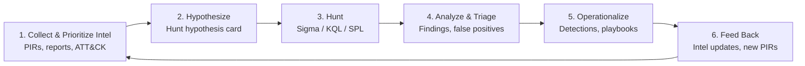

# CTI Hunt Loop Kit

**Intel-driven threat hunting, closed-loop.** A practical kit for turning cyber threat intelligence into testable hunt hypotheses, executing hunts across common SIEM/EDR platforms, and feeding what you find back into your intelligence and detection programs.

> Developed as companion material for a proposed FIRST CTI 2027 workshop and the book *Advanced Cyber Threat Intelligence and Hunting* (Dan Sorensen & Gianluca Tiepolo).

---

## Why a "loop"?

Most teams treat CTI and threat hunting as separate lanes: intel produces reports, hunters produce one-off queries, and the lessons rarely flow back. The Hunt Loop makes the hand-offs explicit so every hunt either **produces a detection**, **improves the intel**, or **retires a bad hypothesis** — and every outcome is recorded.



| Stage | Question it answers | Kit artifact |
|---|---|---|
| 1. Collect & Prioritize | What threats matter to *us* right now? | `templates/pir-worksheet.md` |
| 2. Hypothesize | What would that adversary behavior look like in our telemetry? | `templates/hypothesis-card.md` |
| 3. Hunt | Where and how do we look? | `queries/` (Sigma, KQL, SPL) |
| 4. Analyze | What did we find, and how confident are we? | `templates/hunt-report.md` |
| 5. Operationalize | How do we catch this automatically next time? | `detections/` |
| 6. Feed Back | What did we learn that changes our intel? | `templates/intel-feedback.md` |

## Repository layout

```
cti-hunt-loop-kit/
├── templates/          # PIR worksheet, hypothesis card, hunt report, intel feedback form
├── playbooks/          # ATT&CK-mapped hunt playbooks (one per technique / campaign)
├── queries/
│   ├── sigma/          # Platform-agnostic rules
│   ├── kql/            # Microsoft Sentinel / Defender XDR
│   └── spl/            # Splunk
├── detections/         # (coming soon) Hunts promoted to production detections
├── data/               # (coming soon) Synthetic sample datasets for workshop labs
├── workshop/           # (coming soon) Attendee lab guide and exercises
└── metrics/            # (coming soon) Hunt program KPIs and tracking sheet
```

> **Status:** v0.1. Templates, playbook HL-0001 and its Sigma/KQL/SPL queries are available now; folders marked "coming soon" are being built. See the roadmap below.

## Quick start

1. **Clone the repo**
   ```bash
   git clone https://github.com/DanPazlev/cti-hunt-loop-kit.git
   cd cti-hunt-loop-kit
   ```
2. **Pick a priority intelligence requirement (PIR)** using `templates/pir-worksheet.md`.
3. **Write a hypothesis card** (see [playbooks/](playbooks/) for a worked example) for one ATT&CK technique tied to that PIR.
4. **Run the matching query** from `queries/` against your platform (or the synthetic data in `data/`).
5. **Record the outcome** in `templates/hunt-report.md`, then complete `templates/intel-feedback.md` so the loop closes.

## Hunt hypothesis card (preview)

```markdown
## Hypothesis ID: HL-0001
- Intel source / PIR:
- Adversary / campaign:
- ATT&CK technique(s): e.g., T1059.001 PowerShell
- Hypothesis: "If <adversary> is active in our environment, we expect to see <observable> in <data source>."
- Data sources required:
- Query reference: queries/<platform>/<file>
- Time window:
- Expected benign activity (known noise):
- Outcome: [ ] Confirmed  [ ] Refuted  [ ] Inconclusive (data gap)
- Follow-on: [ ] New detection  [ ] Intel update  [ ] Data-source gap ticket
```

## Measuring the loop

Suggested hunt program metrics (tracked in `metrics/`):

- Hunts completed per PIR
- Hypotheses confirmed / refuted / inconclusive
- Detections created from hunts
- Mean time from intel receipt to first hunt
- Data-source gaps identified and closed
- Intel products updated from hunt findings

## Roadmap

- [x] Core templates (PIR, hypothesis card, hunt report, intel feedback)
- [x] First playbook: HL-0001 encoded PowerShell and download cradles (Sigma, KQL, SPL)
- [ ] Nine more ATT&CK-mapped playbooks with Sigma, KQL, and SPL
- [ ] Synthetic lab dataset and workshop exercises
- [ ] Hunt metrics tracker

## Contributing

Contributions are welcome: new playbooks, query translations, and lessons learned from running the loop in real programs.

1. Fork the repo and create a feature branch.
2. Follow the existing templates and include ATT&CK technique IDs.
3. **Never commit real customer data, IOCs under restrictive TLP, or proprietary telemetry.** Use synthetic or publicly shareable (TLP:CLEAR) material only.
4. Open a pull request describing what you added and how you tested it.

## Disclaimer

This kit is provided for educational and defensive purposes. Test all queries in a non-production environment and tune them for your telemetry before operational use.

## License

Code and content are released under the [Apache License 2.0](LICENSE).

## Author

**Dan Sorensen** — Nexus Security Advisors · OWASP AI Exchange core team · Forbes Technology Council contributor
Co-author, *Advanced Cyber Threat Intelligence and Hunting* (with Gianluca Tiepolo)
